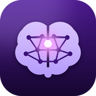
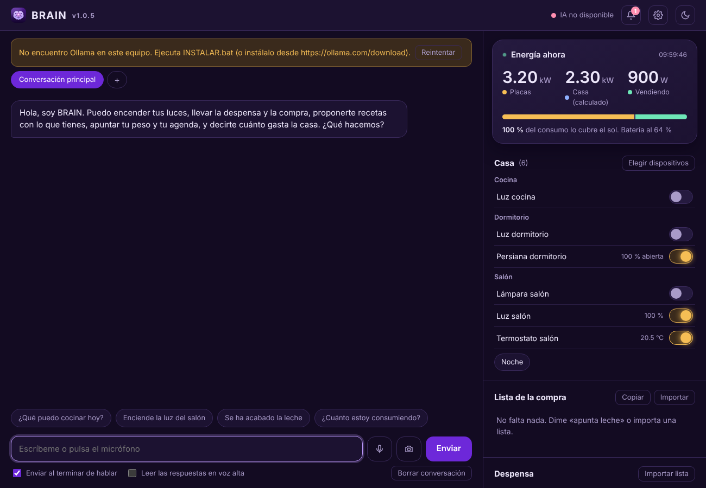
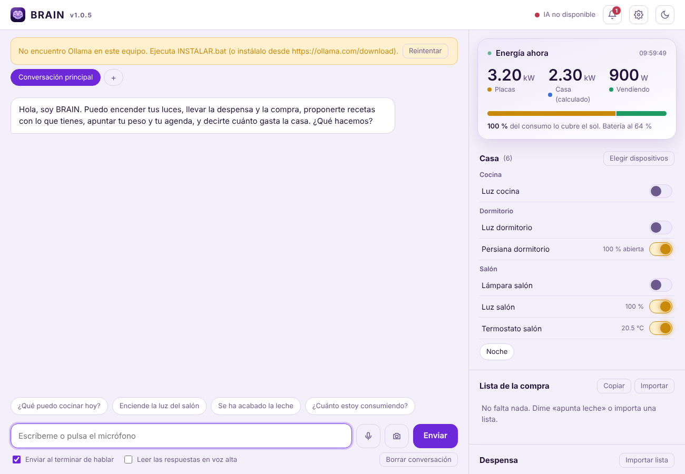
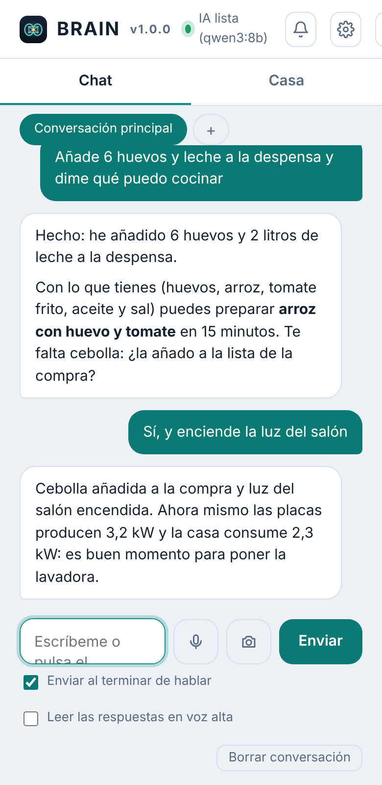
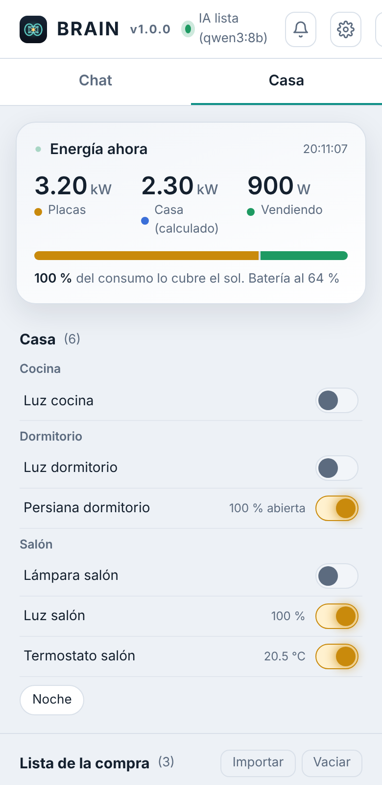

<<<<<<< HEAD
<div align="center">



# BRAIN

**A private, local-first AI assistant for your home — chat, pantry, shopping, solar energy and smart lights, running on your own PC with Ollama.**

[](CHANGELOG.md)
[](LICENSE)
[](tests)
[](#-one-click-install-on-windows)
[](https://www.python.org/)
[](#-requirements--modules)
[](https://ollama.com)

[Install](#-one-click-install-on-windows) · [Features](#-key-features) · [Requirements](#-requirements--modules) · [Remote access](#-use-it-from-your-phone) · [Docs](#-documentation) · [Español](README.es.md)

</div>

---

## 🖥️ See it running

BRAIN is a real desktop app: its own window, a tray icon, notifications with your own sounds, and a local web UI you can also open from your phone. Light and dark themes, responsive down to mobile.

<table>
  <tr>
    <td width="50%"></td>
    <td width="50%"></td>
  </tr>
  <tr>
    <td align="center"><sub>Dark theme</sub></td>
    <td align="center"><sub>Light theme</sub></td>
  </tr>
</table>

<p align="center">
  
  &nbsp;&nbsp;
  
</p>

> The screenshots use demo data against a fake Home Assistant and a stub Ollama, so they show the real UI without exposing anyone's house. The interface text is in Spanish for now.

---

## ✨ Key features

### 🪶 Ultralight core — zero pip dependencies
- Pure Python 3.9+ standard library: `http.server`, `sqlite3`, `threading`, `zipfile`. Nothing to `pip install` for the core.
- Modular by design: drop a file in `brain/modules/` or `brain/tools/builtin/` and it is discovered automatically.
- Data stays on your disk: SQLite for time series, plain JSON you can open in Notepad for everything else. Atomic writes, daily ZIP backups (last 5 kept), one-sentence restore.

### 🧠 Local AI with Ollama
- **Hardware-aware model choice**: measures RAM, NVIDIA VRAM and disk, then pulls the best model that fits.
- Native **tool calling** (70 tools) with a JSON-in-text fallback for models without it; the model chains several tools in one answer.
- Only the tools relevant to the topic are sent on each turn, so a 16k context does not drown in schemas.
- **Parallel conversations** (e.g. one just for recipes), vision model support (read a scale screenshot and store the numbers), local BM25 search over your own manuals and notes.

### 🏠 Smart home via Home Assistant
- Lights, switches, fans, blinds, climate and scenes, with on/off switches in the panel.
- **Safety by design**: locks, garage doors, alarms and doors are never controllable.
- Natural-language automations: *"when the panels pass 3 kW, notify me"*, *"every night at 23:30 turn off the lights"*.

### ☀️ Real-time solar energy
- Auto-detects your inverter and meter sensors: production, house consumption, grid import/export, battery.
- History in SQLite and an optimizer that tells you which hours have spare solar for the washing machine or dishwasher.

### 🥫 Pantry, recipes & shopping
- Paste a messy list (`Milk, 2 units` / `2 x eggs`) and it is parsed into your pantry, fridge or freezer.
- *"We ran out of rice"* → it lands on the shopping list. Recipes consider your pantry **plus** household basics (oil, salt, flour, water…); missing ingredients go to the shopping list in one step.

### 🔔 Real desktop app
- Own window (Edge/Chrome app mode, separate profile, no tabs), tray icon, starts with Windows, single instance.
- Native Windows toasts with **your own sounds** (`.wav`, `.mp3`, `.ogg`, uploaded from Settings), per-type sounds and a do-not-disturb window.
- Daily summary, reminders, calendar alerts and automation alerts that keep sounding when the window is closed.

### 📱 Private remote access
- Optional [Tailscale](https://tailscale.com) integration: reach BRAIN from your phone or another PC, HTTPS, **no router ports opened**, password required, installable as a phone app (PWA).

---

## 📋 Requirements & modules

**Python standard library only** means there is nothing to install for the rows marked ✅. The rows marked 🔌 need an optional service or program; BRAIN keeps working without them and tells you what is missing.

| Capability | Needs | Works with Python stdlib only? |
| --- | :---: | :---: |
| Web UI, desktop window logic, tray, installer scripts | Python 3.9+ | ✅ |
| Pantry · shopping list · calendar · memory · weight tracking | Python 3.9+ | ✅ (use the 70 tools from the console or the UI panels) |
| Backups & restore, SQLite storage, scheduler, reminders, sound notifications | Python 3.9+ | ✅ |
| Document search (BM25 over your `.txt`/`.md`/`.json`) | Python 3.9+ | ✅ |
| Password-protected remote access | Python 3.9+ | ✅ (HTTPS path needs Tailscale, below) |
| **Natural-language chat, recipes, tool calling, automations by voice/text** | 🔌 [Ollama](https://ollama.com) + one model | ❌ |
| Reading a scale screenshot | 🔌 Ollama + a vision-capable model | ❌ |
| **Smart home control, live solar energy, sensor alerts** | 🔌 [Home Assistant](https://www.home-assistant.io) (URL + long-lived token) | ❌ |
| **Microphone (speech to text)** | 🔌 [`faster-whisper`](https://github.com/SYSTRAN/faster-whisper) (+ `numpy`), installed on demand from the UI; local, model downloaded once | ❌ |
| Remote access from phone / other PC | 🔌 [Tailscale](https://tailscale.com) | ❌ |
| Own app window | Microsoft Edge or Chrome (Edge ships with Windows); falls back to your default browser | ✅ |

**First thing to try (no Home Assistant, no microphone needed):** install, open BRAIN and say
*"Add 6 eggs and 2 litres of milk to the pantry"* → *"What can I cook with what I have?"* → *"Remind me in 20 minutes to take the chicken out"*.
Then connect Home Assistant (`CONFIGURAR_DOMOTICA.bat`) or the microphone when you want them.

Hardware: any PC that can run a 4B model works (8 GB RAM); a 12 GB+ NVIDIA GPU unlocks the 12B–27B models.

---

## 🚀 One-click install on Windows

No terminal, no `pip`, no config files.

1. **Download** the repo as ZIP and extract it (don't run from inside the ZIP).
2. **Double-click `INSTALAR.bat`.** It installs Python and Ollama if missing, measures your PC, downloads the best model that fits and creates the **BRAIN** icon on your desktop and Start menu (with the logo), set to start with Windows.
3. **Double-click the BRAIN icon.** Done.

Prefer a wizard installer? Double-click **`CREAR_SETUP.bat`** once: it builds a single **`instalbrain (version).exe`** (with Inno Setup) you can copy to any PC. Python is bundled, there is no console window, it installs to `%LOCALAPPDATA%\BRAIN`, keeps your data on updates and registers an uninstaller under *Settings → Apps*.

| File | What it does |
| --- | --- |
| `INSTALAR.bat` | One-time setup: Python, Ollama, model, shortcuts, autostart |
| `CREAR_SETUP.bat` | Builds a shareable `instalbrain (version).exe` wizard |
| `INICIAR.bat` | Starts BRAIN as a desktop app (own window + tray icon) |
| `INICIAR_NAVEGADOR.bat` | Starts BRAIN in your browser instead |
| `INICIAR_CONSOLA.bat` | Chat in a terminal window |
| `CERRAR_BRAIN.bat` | Fully quits BRAIN (also: tray icon → *Quit*, or Settings → *Close BRAIN*) |
| `MEJORAR_IA.bat` | Re-measures your PC and picks a better model |
| `CONFIGURAR_DOMOTICA.bat` | Connects Home Assistant ([guide](GUIA_DOMOTICA.md)) |
| `CONFIGURAR_ENERGIA.bat` | Picks the inverter sensors for live energy |
| `CONFIGURAR_ACCESO.bat` | Sets the password and publishes BRAIN on your Tailscale network |
| `DIAGNOSTICO.bat` | Shows what is installed and what is failing |

**Linux / macOS:** `python3 main.py` (needs Python 3.9+ and [Ollama](https://ollama.com/download) with a model, e.g. `ollama pull qwen3:4b`). Variants: `--escritorio`, `--consola`, `--diagnostico`, `--mejorar-ia`.

---

## 📱 Use it from your phone

1. Install Tailscale on the PC running BRAIN and on your phone (same account).
2. Double-click `CONFIGURAR_ACCESO.bat`, choose a password (8+ chars).
3. Open the `https://<your-pc>.<tailnet>.ts.net` address it prints, sign in, and *Add to Home Screen*.

BRAIN itself only listens on `127.0.0.1`. Tailscale publishes it inside your private network; requests that arrive that way must carry a signed session cookie (PBKDF2 password, 30-day HMAC session, lockout after 5 wrong tries, `Host`/`Origin` checks). Full guide: [`ACCESO_DESDE_EL_MOVIL.md`](ACCESO_DESDE_EL_MOVIL.md).

---

## 🧰 What the assistant can do (70 tools)

| Area | Examples |
| --- | --- |
| 🥫 Pantry (8) | `anadir_varios_inventario`, `se_ha_acabado`, `buscar_inventario` |
| 🛒 Shopping (6) | `anadir_a_compra`, `anadir_faltantes_receta_a_compra`, `marcar_comprado` |
| 🍳 Recipes (5) | `ingredientes_disponibles`, `ver_basicos`, `anadir_basico` |
| 💡 Smart home (8) | `encender`, `apagar`, `regular_luz`, `activar_escena`, `ver_dispositivos` |
| ⚡ Energy (4) | `ver_energia_ahora`, `ver_consejo_energia`, `ver_produccion_solar` |
| 🔔 Alerts (9) | `crear_recordatorio`, `asignar_sonido`, `configurar_avisos` |
| ⚙️ Automations (5) | `crear_automatizacion`, `ejecutar_automatizacion` |
| 🩺 Health (5) | `guardar_peso`, `ver_medidas_corporales` (scale screenshots) |
| 🔧 Appliances (4) | `anadir_electrodomestico`, `consultar_electrodomestico` (diagnose with your manuals) |
| 📅 Calendar · 🧠 Memory · 📄 Documents · 🗂️ System · 📊 Summary | agenda, long-term memory, BM25 manual search, backups, daily summary |

Tool names are Spanish identifiers (the project's UI language); they are plain Python functions registered with an `@tool` decorator.

---

## 🧩 Architecture

```text
BRAIN/
├── main.py                     # --escritorio | --web | --consola | --configurar-acceso | ...
├── brain/
│   ├── core/                   # Brain, config, SQLite (database.py), scheduler, notifier, hardware
│   ├── ai/                     # Ollama client, tool-calling loop, vision, tool filtering
│   ├── modules/                # pantry, shopping, energy, domotics, alerts, backups, documents...
│   ├── tools/builtin/          # the 70 tools exposed to the model
│   ├── integrations/           # Home Assistant REST client
│   ├── voice/                  # conversations + local Whisper (windowed-sinc resampling)
│   ├── web/                    # http.server UI + password/session layer + PWA
│   └── escritorio/             # app window, tray icon, autostart, single instance, Tailscale wizard
├── instalador/                 # Inno Setup wizard script and its builder
├── scripts/instalar.ps1        # Python + Ollama + model setup
├── tests/                      # 297 tests, no Ollama or Home Assistant needed
└── datos/                      # your data (never committed): SQLite, JSON, sounds, backups
```

A change in one module never requires touching another. Tests use a stub Ollama and a stub Home Assistant, so the suite runs anywhere:

```bash
python -m unittest discover -s tests -t .
```

---

## ⚙️ Configuration

All optional, via environment variables:

| Variable | Purpose | Default |
| --- | --- | --- |
| `BRAIN_MODELO` | Force a specific model (e.g. `qwen3:8b`) | best installed |
| `BRAIN_DATOS` | Data folder | `datos/` |
| `BRAIN_OLLAMA_URL` | Ollama address (`OLLAMA_HOST` also works) | `http://127.0.0.1:11434` |
| `BRAIN_HA_URL` / `BRAIN_HA_TOKEN` | Home Assistant (alternative to the setup script) | stored in `datos/domotica/` |
| `BRAIN_CONTEXTO` | Context window in tokens | `16384` |
| `BRAIN_PUERTO` | Web UI port | `8765` |
| `BRAIN_VOZ_MODELO` | Whisper size (`base`, `small`, `medium`) | by RAM |
| `BRAIN_PENSAR` | `1` enables Qwen 3 thinking mode | off |
| `BRAIN_SONDEO_SEGUNDOS` / `BRAIN_PLANIFICADOR` | Home Assistant polling interval / disable the scheduler | 120 / on |

---

## 🔒 Privacy & honesty

- Everything runs on your machine. No telemetry, no cloud calls (except downloading Ollama models, Whisper models and Python packages when you ask for them).
- BRAIN never operates locks, garage doors or alarms, whatever the model says.
- **Tested vs. unverified:** the 393 tests cover the logic, the server, the auth layer, the scheduler and the install scripts' structure. The Windows-only shell pieces — tray icon, toast notifications, the Edge app window, the installer `.exe` build and Whisper on real audio — were written to Microsoft's documented behaviour but could not be exercised on a real Windows machine in CI. Bug reports from Windows users are very welcome.

---

## 📚 Documentation

- [`INSTRUCCIONES_WINDOWS.md`](INSTRUCCIONES_WINDOWS.md) — step-by-step Windows guide and troubleshooting (Spanish)
- [`ACCESO_DESDE_EL_MOVIL.md`](ACCESO_DESDE_EL_MOVIL.md) — phone / remote access with Tailscale (Spanish)
- [`GUIA_DOMOTICA.md`](GUIA_DOMOTICA.md) — connecting Home Assistant (Spanish)
- [`CHANGELOG.md`](CHANGELOG.md) · [`docs/ROADMAP.md`](docs/ROADMAP.md)
- [`README.es.md`](README.es.md) — the previous Spanish README

## 🗺️ Roadmap

Voice control without a screen · smarter energy automations · multi-room presence · English UI.

## 🤝 Contributing

Issues and PRs welcome. The golden rules: standard library only in the core, every feature ships with tests, and optional services must degrade gracefully.

---

<div align="center"><sub>BRAIN — your data, your hardware, your assistant.</sub></div>
=======
# BRAIN

**B**ase de **R**azonamiento y **A**utomatización con **I**nteligencia **N**atural (Base of Reasoning and Automation with Natural Intelligence).

BRAIN is a modular personal assistant designed to centralize information, automate tasks, and leverage local artificial intelligence to assist with daily life.

The ultimate goal is to turn it into the digital brain of your home and personal workflow, integrating AI, memory, automation, smart home control, health, energy, inventory, voice control, and other services into a single unified platform.

---

## Quick Installation on Windows

1. Download the project and extract it (for example, to `C:\BRAIN`).
2. Double-click on **`INSTALAR.bat`** and wait. It installs Python and Ollama if missing, downloads the AI model, and creates a **BRAIN** shortcut on your desktop.
3. Double-click the **BRAIN** shortcut (or `INICIAR.bat`). Your browser will open with the chat interface.

Step-by-step guide and troubleshooting: [`INSTRUCCIONES_WINDOWS.md`](INSTRUCCIONES_WINDOWS.md).

| File | Description |
| --- | --- |
| `INSTALAR.bat` | Installs everything required (first time only) |
| `INICIAR.bat` | Opens BRAIN with a local web interface in your browser |
| `INICIAR_CONSOLA.bat` | Opens BRAIN as a console chat in a terminal window |
| `DIAGNOSTICO.bat` | Checks system status, installations, and potential issues |
| `MEJORAR_IA.bat` | Analyzes your PC hardware and downloads the best fitting AI model |
| `CONFIGURAR_ENERGIA.bat` | Selects your inverter sensors for real-time solar production & consumption tracking |
| `CONFIGURAR_DOMOTICA.bat` | Connects BRAIN with Home Assistant to control your home ([guide](GUIA_DOMOTICA.md)) |

For Linux or macOS: `python3 main.py` (web), `python3 main.py --consola`, or `python3 main.py --diagnostico`. Requires Python 3.9 or higher and [Ollama](https://ollama.com/download) with a model (`ollama pull qwen3:4b`). No external Python `pip` packages required.


### Core

- ✅ Main `Brain` class
- ✅ Dynamic module loading system
- ✅ Centralized `DataManager` (atomic writes, resilient to corrupted files and Windows file locks)
- ✅ `GestorConocimiento` (personality and permanent memory)
- ✅ JSON-based data persistence
- ✅ Modular and scalable architecture (`ModuloBase`)
- ✅ Event and error logging in `datos/logs/`

### Modules

- ✅ Health (weight tracking and history)
- ✅ Inventory & Pantry management
- ✅ Energy (historical solar production and real-time inverter consumption/production)
- ✅ Calendar (events and tasks)
- ✅ Shopping lists
- ✅ Memory
- ✅ Sensors
- ✅ Smart Home / Domotics (lights, plugs, blinds, climate, and scenes via Home Assistant)

### Tool Calling System

Tools are functions that the AI can invoke to query and modify data. They use a simple decorator and are auto-discovered: just drop a new file into `brain/tools/builtin/`.

- **Health:** `guardar_peso`, `obtener_peso`, `peso_en_fecha`, `historial_peso`
- **Inventory:** `anadir_inventario`, `anadir_varios_inventario`, `quitar_inventario`, `se_ha_acabado`, `ver_inventario`, `buscar_inventario`, `borrar_del_inventario`, `vaciar_inventario`
- **Shopping:** `anadir_a_compra`, `anadir_varias_a_compra`, `ver_lista_compra`, `marcar_comprado`, `quitar_de_compra`, `vaciar_lista_compra`
- **Calendar:** `anadir_evento`, `anadir_tarea`, `completar_tarea`, `ver_agenda`
- **Energy:** `guardar_produccion_solar`, `ver_produccion_solar`, `ver_energia_ahora`
- **Recipes:** `ingredientes_disponibles` (pantry + house basics), `ver_basicos`, `anadir_basico`, `quitar_basico`
- **Memory:** `recordar`, `consultar_memoria`, `olvidar`
- **Sensors:** `guardar_sensor`, `ver_sensor`
- **Smart Home:** `encender`, `apagar`, `regular_luz`, `mover_persiana`, `poner_temperatura`, `activar_escena`, `ver_dispositivos`, `estado_dispositivo`

### Artificial Intelligence

- ✅ Native Ollama integration (custom client, zero external dependencies)
- ✅ Hardware detection (RAM, NVIDIA GPU, disk) to pick the best model: Qwen 3.8 27B, Gemma 4 (26B / 12B / E4B / E2B), or Qwen 3 4B
- ✅ `BrainAI` as an abstract AI layer
- ✅ Native Ollama tool-calling, with fallback mechanisms for models lacking native tool support
- ✅ Multi-tool chaining within a single turn
- ✅ Context-aware AI (personality, current date/time, and permanent memory)

### Conversation & Interfaces

- ✅ Persistent conversation history (remembers across restarts)
- ✅ Historical queries ("how much did I weigh on August 5th?")
- ✅ Local web interface (light/dark theme, mobile friendly): live energy stats, switchable smart devices, pantry management, shopping lists, bulk list importer, local microphone dictation, and text-to-speech output
- ✅ Console chat mode

### Tests

- ✅ 177 automated tests (run locally without needing Ollama or touching your personal data)
- ✅ `scripts/probar_ia.py` utility for real Ollama connection testing

```text
python -m unittest discover -s tests -t .
>>>>>>> 84cb45a321c908149c3d3b8d4d77c1e0d48efb80
